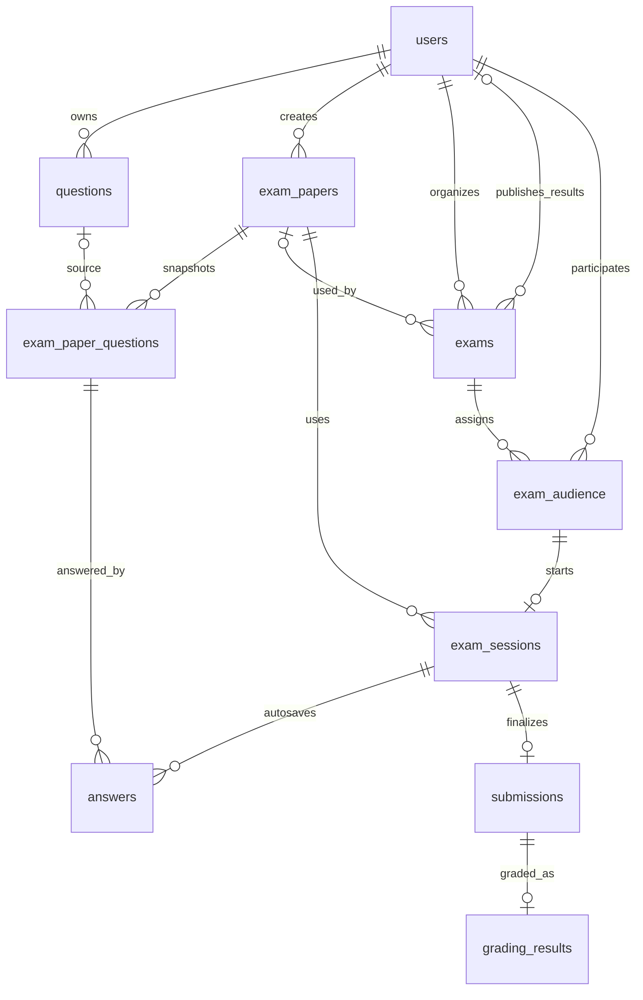

# Thiết kế cơ sở dữ liệu UniExam cho backend Python

Bản thiết kế đề xuất dùng PostgreSQL 16 trở lên, có thể ánh xạ bằng SQLAlchemy và quản lý migration bằng Alembic. Mô hình phục vụ ba vai trò sinh viên, giáo viên, quản trị viên; hỗ trợ trắc nghiệm, một ô điền khuyết trong mỗi câu, lịch công bố kỳ thi và công bố kết quả sớm do giáo viên xác nhận.

Đây là thiết kế cho backend Python dự kiến. SQL trong `schema-proposal.sql` là bản khởi tạo cho database hoặc schema mới, không phải migration để chạy trực tiếp lên database Node.js đang sử dụng. Các tên bảng được giữ để dễ đối chiếu; các trường đáp án văn bản, khóa ngoại ghép và thông tin người công bố là những thay đổi cần chuyển đổi dữ liệu khi triển khai.

## 1 Quy ước chung

- Khóa chính dùng `UUID`; bảng nối `exam_audience` dùng khóa chính ghép.
- Thời gian dùng `TIMESTAMPTZ`; truyền ISO 8601 có múi giờ, thống nhất kết nối backend theo UTC, giao diện hiển thị giờ Việt Nam.
- Điểm dùng `NUMERIC`, không dùng số thực `FLOAT` để cộng điểm.
- Tên đăng nhập và email không phân biệt hoa/thường qua unique index trên `lower(...)`.
- `NULL` thể hiện chưa có giá trị; ví dụ chưa công bố kết quả hoặc chưa trả lời văn bản.
- Mỗi sinh viên có tối đa một phiên làm bài cho một kỳ thi. Một phiên có tối đa một bài nộp; một bài nộp có tối đa một bản ghi tổng điểm.
- `updated_at` của các bảng có trường này được cập nhật bằng trigger.

## 2 Sơ đồ quan hệ

## 3 Từ điển dữ liệu

Các cột `id` bên dưới đều là khóa chính UUID, tự sinh bằng `gen_random_uuid()`, trừ bảng nối có ghi riêng. `FK` là khóa ngoại, `UQ` là ràng buộc duy nhất. Chi tiết độ dài, giá trị mặc định, CHECK và index nằm trong file SQL đi kèm.

### users

Lưu chung các vai trò để thống nhất đăng nhập và khóa tài khoản.

| Cột | Kiểu | Ý nghĩa |
|---|---|---|
| id | UUID | PK |
| username | VARCHAR(100) | Tên đăng nhập; UQ không phân biệt hoa/thường |
| full_name | VARCHAR(200) | Họ tên |
| email | VARCHAR(254), NULL | Email; UQ không phân biệt hoa/thường khi có giá trị |
| password_hash | TEXT | Chuỗi băm mật khẩu, không lưu mật khẩu gốc |
| role | VARCHAR(20) | student, teacher, admin |
| is_active | BOOLEAN | Trạng thái được phép sử dụng tài khoản |
| created_at, updated_at | TIMESTAMPTZ | Thời điểm tạo và cập nhật |

### questions

Ngân hàng câu hỏi do giáo viên hoặc quản trị viên tạo.

| Cột | Kiểu | Ý nghĩa |
|---|---|---|
| id | UUID | PK |
| owner_id | UUID | FK users.id; người tạo |
| subject | VARCHAR(200) | Tên môn học |
| chapter, topic | VARCHAR(200) | Chương, chủ đề |
| difficulty | VARCHAR(10) | easy, medium, hard |
| type | VARCHAR(30) | multiple_choice hoặc fill_blank |
| content | TEXT | Nội dung, tối đa 5000 ký tự |
| options | JSONB | Các lựa chọn dạng `[{"id":"A","text":"..."}]` |
| correct_option_ids | TEXT[] | Mã các lựa chọn đúng; chỉ dùng cho trắc nghiệm |
| accepted_answers | TEXT[] | Các đáp án văn bản được chấp nhận; chỉ dùng cho điền khuyết |
| points | NUMERIC(6,2) | Điểm của câu, lớn hơn 0 và không quá 100 |
| created_at, updated_at | TIMESTAMPTZ | Thời điểm tạo và cập nhật |

Trắc nghiệm có 2–8 lựa chọn, ít nhất một mã đáp án đúng, mã lựa chọn duy nhất và mọi mã đáp án đều thuộc lựa chọn. Điền khuyết có `options = []`, `correct_option_ids = {}`, từ 1–8 đáp án văn bản, mỗi đáp án tối đa 500 ký tự. Hàm CHECK `question_payload_valid` kiểm tra các điều kiện này.

Môn học được giữ dưới dạng văn bản để phù hợp cách nhập môn học hiện tại. Backend chuẩn hóa khoảng trắng trước khi lưu và khi lọc. Chưa cần bảng môn học riêng khi chưa có chức năng mã môn, phân công giảng dạy hay quản lý chương trình học.

### exam_papers

Đề thi có thể được sử dụng cho nhiều kỳ thi.

| Cột | Kiểu | Ý nghĩa |
|---|---|---|
| id | UUID | PK |
| owner_id | UUID | FK users.id |
| title, subject | VARCHAR(200) | Tên đề, môn học |
| description | TEXT | Mô tả |
| created_at, updated_at | TIMESTAMPTZ | Thời điểm tạo và cập nhật |

### exam_paper_questions

Bản chụp các câu hỏi của đề. Đây là nguồn dữ liệu để hiển thị và chấm bài; không đọc lại nội dung hoặc đáp án từ ngân hàng khi chấm.

| Cột | Kiểu | Ý nghĩa |
|---|---|---|
| id | UUID | PK; mã câu hỏi trong đề |
| paper_id | UUID | FK exam_papers.id |
| question_id | UUID, NULL | FK questions.id; câu hỏi nguồn có thể bị xóa |
| position | INTEGER | Số thứ tự; UQ theo từng đề |
| type, content, options | Như questions | Bản chụp loại câu, nội dung, lựa chọn |
| correct_option_ids, accepted_answers | TEXT[] | Bản chụp đáp án đúng |
| points, chapter, topic, difficulty | Như questions | Điểm và thông tin phân loại tại lúc tạo đề |

UQ `(paper_id, question_id)` tránh đưa cùng câu hỏi nguồn vào một đề hai lần. Khi xóa câu hỏi nguồn chỉ đặt `question_id = NULL`, không xóa bản chụp. Sau khi đề đã được dùng trong kỳ thi phát hành, backend không cho sửa bản chụp; sửa nội dung phải tạo đề mới.

### exams

Kỳ thi gắn một đề, lịch thi và danh sách thí sinh.

| Cột | Kiểu | Ý nghĩa |
|---|---|---|
| id | UUID | PK |
| owner_id | UUID | FK users.id; người tổ chức |
| paper_id | UUID, NULL | FK exam_papers.id; cho phép chưa chọn khi còn nháp |
| title, subject, description | VARCHAR/TEXT | Thông tin kỳ thi |
| publish_at | TIMESTAMPTZ, NULL | Giờ hiện kỳ thi cho sinh viên; NULL nghĩa là hiện ngay khi phát hành |
| start_time, end_time | TIMESTAMPTZ | Khung thời gian làm bài |
| duration_minutes | INTEGER | Thời lượng mỗi phiên, 1–600 phút |
| question_count | INTEGER | Số câu cấu hình; phải khớp số câu trong đề khi phát hành |
| status | VARCHAR(20) | draft, published, open, locked, closed |
| results_published | BOOLEAN | Giáo viên đã xác nhận công bố kết quả hay chưa |
| results_published_at | TIMESTAMPTZ, NULL | Thời điểm công bố kết quả |
| results_published_by | UUID, NULL | FK users.id; người xác nhận công bố |
| created_at, updated_at | TIMESTAMPTZ | Thời điểm tạo và cập nhật |

`end_time > start_time`; nếu có lịch thì `publish_at <= start_time`. Kỳ thi đã phát hành phải có đề. Trạng thái công bố kết quả phải nhất quán với thời điểm, người công bố và trạng thái `closed`.

Ba mốc thời gian có ý nghĩa khác nhau: giờ công bố kỳ thi, giờ được bắt đầu làm bài, giờ giáo viên công bố kết quả. Giáo viên có thể đặt giờ công bố bằng giờ bắt đầu nếu không muốn kỳ thi xuất hiện trước.

### exam_audience

Quan hệ nhiều–nhiều giữa kỳ thi và sinh viên.

| Cột | Kiểu | Ý nghĩa |
|---|---|---|
| exam_id | UUID | FK exams.id; thành phần PK |
| student_id | UUID | FK users.id; thành phần PK |
| assigned_at | TIMESTAMPTZ | Thời điểm được chỉ định |

PK `(exam_id, student_id)` tránh chỉ định trùng. Đây là danh sách để xét tất cả thí sinh đã hoàn thành, bao gồm người chưa vào thi. Backend chỉ cho chỉ định tài khoản có vai trò sinh viên và chỉ sửa danh sách khi kỳ thi còn nháp.

### exam_sessions

Một phiên làm bài cho mỗi sinh viên trong mỗi kỳ thi.

| Cột | Kiểu | Ý nghĩa |
|---|---|---|
| id | UUID | PK |
| exam_id, student_id | UUID | FK ghép tới exam_audience; UQ |
| paper_id | UUID | Cùng exam_id tạo FK ghép tới exams; bảo đảm đúng đề của kỳ thi |
| status | VARCHAR(20) | in_progress hoặc submitted |
| started_at, expires_at | TIMESTAMPTZ | Giờ bắt đầu và hạn chót |
| submitted_at | TIMESTAMPTZ, NULL | Thời điểm thực tế nộp bài |
| submit_reason | VARCHAR(20), NULL | student hoặc timeout |

Backend tính `expires_at = min(started_at + duration_minutes, end_time)`. Sau khi đã nộp phải có thời điểm và lý do nộp; không tạo phiên mới để thi lại. Sinh viên ngoài danh sách không thể tạo phiên vì FK ghép.

### answers

Dữ liệu làm bài được tự lưu, được chụp lại khi nộp bài.

| Cột | Kiểu | Ý nghĩa |
|---|---|---|
| id | UUID | PK |
| session_id | UUID | Phiên làm bài |
| paper_id | UUID | Đề thi, dùng trong FK ghép để chống lưu nhầm câu hỏi khác đề |
| question_id | UUID | FK ghép tới exam_paper_questions |
| selected_option_ids | TEXT[] | Các mã lựa chọn sinh viên đã chọn |
| text_answer | VARCHAR(500), NULL | Văn bản sinh viên nhập cho câu điền khuyết |
| flagged | BOOLEAN | Đánh dấu xem lại |
| updated_at | TIMESTAMPTZ | Lần tự lưu gần nhất |

UQ `(session_id, question_id)` để autosave bằng upsert. Một hàng không đồng thời có lựa chọn trắc nghiệm và văn bản. Backend còn phải kiểm tra kiểu câu, mã lựa chọn thuộc câu hỏi và phiên chưa nộp/chưa hết giờ. Bỏ trống: `selected_option_ids = {}`, `text_answer = NULL`.

### submissions

Bài nộp cố định và hàng đợi chấm điểm.

| Cột | Kiểu | Ý nghĩa |
|---|---|---|
| id | UUID | PK |
| session_id | UUID | UQ; mỗi phiên có một bài nộp |
| exam_id, student_id | UUID | FK ghép cùng session_id để không gắn nhầm kỳ thi hoặc sinh viên |
| answers_snapshot | JSONB | Bản chụp câu trả lời lúc nộp |
| status | VARCHAR(30) | pending_grading, grading, graded, failed |
| submitted_at, claimed_at, graded_at | TIMESTAMPTZ | Thời điểm nộp, nhận chấm, chấm xong |
| attempts | INTEGER | Số lần worker nhận chấm |
| fail_reason | TEXT, NULL | Lỗi chấm gần nhất |

Ví dụ một phần tử snapshot: `{"question_id":"...","selected_option_ids":[],"text_answer":"Hà Nội"}`. Worker dùng snapshot, không đọc đáp án autosave đang thay đổi. Trong cùng transaction, backend khóa phiên, chụp đáp án, đánh dấu đã nộp và tạo bài nộp; request lặp trả lại cùng bài nộp.

### grading_results

Kết quả chấm của một bài nộp.

| Cột | Kiểu | Ý nghĩa |
|---|---|---|
| id | UUID | PK |
| submission_id | UUID | FK submissions.id, UQ |
| score, max_score | NUMERIC(8,2) | Điểm đạt và tổng điểm; `0 <= score <= max_score`, `max_score > 0` |
| details | JSONB | Kết quả từng câu: question_id, correct, earned, max, đáp án đã trả lời |
| graded_by | VARCHAR(100) | Mã tiến trình chấm, không phải mật khẩu hoặc tên đăng nhập |
| created_at | TIMESTAMPTZ | Thời điểm ghi kết quả |

Worker ghi kết quả và cập nhật `submissions.status = graded` trong cùng transaction. Một bài có thể chấm lại theo quy trình riêng bằng cách cập nhật bản ghi kết quả, không sinh nhiều hàng tổng điểm.

## 4 Điều kiện công bố kết quả

Việc công bố là tùy chọn do giáo viên hoặc quản trị viên có quyền xác nhận, không phải trigger tự động trong database.

1. Kỳ thi đã phát hành và kết quả chưa công bố.
2. Không có phiên `in_progress` của kỳ thi.
3. Mọi bài đã nộp đều ở trạng thái `graded` và có bản ghi `grading_results`.
4. Nếu chưa đến hết kỳ thi: danh sách dự thi không rỗng và mọi người trong `exam_audience` đều có phiên đã nộp cùng bài nộp.
5. Nếu kỳ thi đã đóng sau giờ kết thúc: cho phép có thí sinh vắng; chỉ cần các bài thực tế đã nộp đều chấm xong và không còn phiên đang làm.
6. Khi công bố, cập nhật đồng thời `status = closed`, `results_published = true`, `results_published_at`, `results_published_by`.

Các điều kiện đếm nhiều hàng phải kiểm tra tại Service và cập nhật có điều kiện trong transaction; không dùng CHECK có truy vấn bảng khác. Chỉ API trả điểm và đáp án cho sinh viên khi đã được công bố. FK/CHECK không thay thế việc xác thực và phân quyền.

## 5 Ràng buộc và trách nhiệm của backend

| Database bảo đảm | Service Python kiểm tra bổ sung |
|---|---|
| PK, FK, tài khoản và email duy nhất | Vai trò, tài khoản hoạt động, quyền sở hữu |
| Đáp án chuẩn của câu hỏi hợp lệ | Chuẩn hóa Unicode NFC, quy tắc so khớp điền khuyết |
| Phiên thuộc danh sách và đúng đề | Đã đến giờ công bố/bắt đầu, kỳ thi cho phép làm bài |
| Câu trả lời thuộc cùng đề của phiên | Loại câu trả lời đúng loại câu hỏi; mã lựa chọn tồn tại; phiên còn hạn |
| Không tạo trùng phiên, đáp án, bài nộp, kết quả | Khóa hàng và transaction khi nộp, chấm và công bố |
| Thứ tự lịch và cấu trúc dữ liệu hợp lệ | Khung giờ đủ thời lượng, số câu khớp với đề, đề không rỗng khi phát hành |

Đáp án điền khuyết được chuẩn hóa Unicode NFC, bỏ khoảng trắng thừa và không phân biệt hoa/thường khi so khớp; vẫn phân biệt dấu tiếng Việt. Dữ liệu gốc sinh viên nhập được lưu để xem lại.

Khi một đề đã được dùng trong kỳ thi phát hành, Service không cho sửa/xóa các bản chụp của đề. Khi phiên đã nộp, Service không cho sửa đáp án hoặc snapshot. Các CHECK trong SQL không tự bảo đảm tính bất biến của những hàng này.

## 6 Chính sách xóa và lưu lịch sử

- Khóa tài khoản bằng `is_active = false` thay vì xóa tài khoản có lịch sử.
- Xóa câu hỏi ngân hàng không ảnh hưởng bản chụp đề thi vì FK `ON DELETE SET NULL`.
- Chỉ Service được cho xóa kỳ thi nháp hoặc đề chưa sử dụng. FK chặn xóa đề đang được kỳ thi tham chiếu.
- FK ghép chặn xóa đối tượng dự thi đã có phiên làm bài; không xóa bài nộp hoặc điểm trong luồng sử dụng thông thường.
- CASCADE chỉ dùng cho dữ liệu phụ thuộc đã được xác định rõ: câu hỏi trong đề chưa sử dụng, danh sách của kỳ thi chưa có phiên, đáp án khi xóa phiên qua quy trình bảo trì.

## 7 Index và truy cập thường dùng

- `users(lower(username))`: đăng nhập.
- `questions(owner_id, subject, difficulty)`: tìm câu hỏi của giáo viên theo môn và độ khó.
- `exam_paper_questions(paper_id, position)`: tải đề theo thứ tự.
- `exam_audience(student_id, exam_id)`: danh sách kỳ thi của sinh viên.
- `exam_sessions(expires_at) WHERE status = in_progress`: xử lý hết giờ.
- `answers(session_id, question_id)`: tự lưu và tải đáp án.
- `submissions(status, submitted_at)` và `claimed_at`: nhận bài chấm, xử lý worker bị gián đoạn.
- `grading_results(submission_id)`: lấy kết quả bài nộp.

Worker nhận bài trong transaction với khóa hàng và `SKIP LOCKED` để các worker không nhận cùng bài. Số lần thử và thời hạn nhận chấm do cấu hình backend quyết định.

## 8 Hướng chuyển từ database hiện tại

1. Không chạy SQL khởi tạo này lên database hiện tại. Tạo migration Alembic riêng và thử trên bản sao dữ liệu.
2. Thêm `accepted_answers` cho câu hỏi ngân hàng và bản chụp. Với `fill_blank`, chuyển dữ liệu đang nằm trong `correct_option_ids` sang trường mới rồi làm rỗng trường cũ.
3. Thêm `text_answer` cho đáp án; chuyển phần tử văn bản đang nằm trong `selected_option_ids` sang trường mới cho các câu điền khuyết. Chuyển cả JSON snapshot và chi tiết kết quả bằng script riêng theo loại câu hỏi.
4. Bổ sung `paper_id` trong phiên/đáp án bằng cách nối theo kỳ thi và câu hỏi; kiểm tra dữ liệu sai liên kết trước khi thêm FK ghép.
5. Bổ sung người công bố. Dữ liệu lịch sử chưa biết người công bố phải được xử lý có xác nhận trước khi bật ràng buộc chặt; không tự gán một giáo viên bất kỳ.
6. Đối chiếu số tài khoản, câu hỏi, phiên, bài nộp và điểm trước/sau chuyển đổi. Kiểm tra frontend/API theo hợp đồng mới trước khi triển khai.

## 9 Tài liệu kỹ thuật tham khảo

- [PostgreSQL constraints](https://www.postgresql.org/docs/current/ddl-constraints.html): PK, FK, UNIQUE, CHECK và giới hạn CHECK liên quan dữ liệu bảng khác.
- [PostgreSQL date and time](https://www.postgresql.org/docs/current/datatype-datetime.html): kiểu thời gian có múi giờ.
- [PostgreSQL JSON types](https://www.postgresql.org/docs/current/datatype-json.html): lưu lựa chọn, snapshot và chi tiết chấm bằng JSONB.
